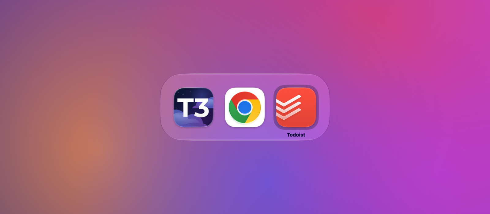
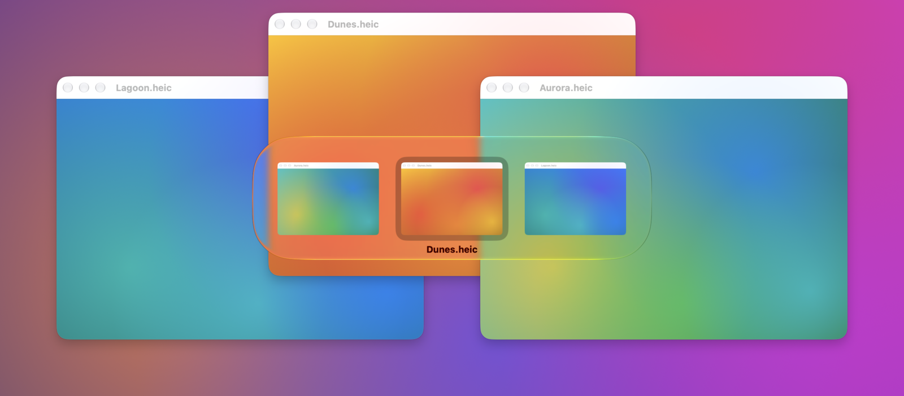
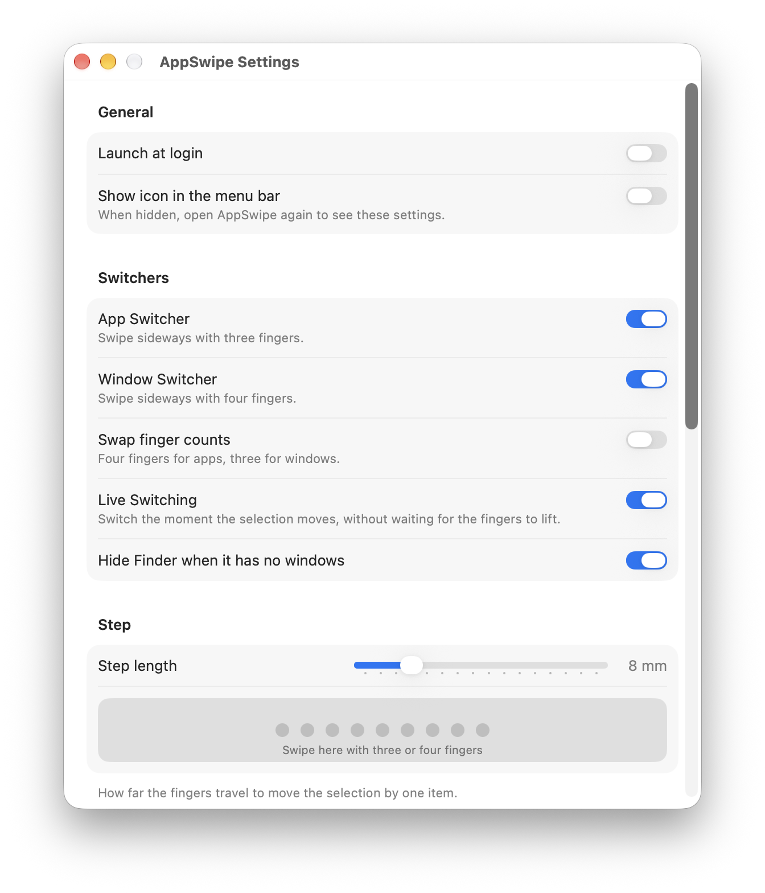

# AppSwipe

Switch apps and windows on a Mac with trackpad swipes. Swipe sideways with three fingers for an app switcher like Cmd-Tab, or down for the windows of the app you're in. The switcher follows your fingers, and lifting them switches.





## Install

Requires macOS 26 or later.

```sh
brew install --cask lebedev-nikita/tap/app-swipe
```

Releases are signed with a self-signed certificate and are not notarized by Apple. If macOS blocks AppSwipe the first time, open System Settings → Privacy & Security and click Open Anyway.

AppSwipe asks for two permissions:

- **Accessibility**, to read swipes and switch apps and windows. Required.
- **Screen Recording**, for window previews. Optional: without it the Window Switcher shows app icons. Takes effect after AppSwipe restarts.

macOS uses the same swipes to move between full-screen apps and for App Exposé. Turn those off under Trackpad Gestures in AppSwipe's settings, which can restore them later. Restore them before uninstalling AppSwipe, since removing the app leaves them off.

Update with:

```sh
brew update
brew upgrade --cask app-swipe
```

## Use

- Swipe sideways with three fingers and keep moving to step through apps, most recently used first. Lift to switch. A quick flick switches straight to the previous app.
- Swipe down with three fingers, then sideways, to step through the active app's windows on the current Space.
- While stepping through apps, move the fingers down to step through the selected app's windows, and up to go back to the apps.
- To cancel, move back to the first item and lift, or press Esc.

Settings open from the menu bar icon, or by opening AppSwipe again while the icon is hidden. While they are open, ⌘W closes them and ⌘Q quits AppSwipe. They can pause AppSwipe, switch to four-finger swipes, limit each switcher to the display with the pointer, switch the moment the selection moves, change the step length, and turn AppSwipe off in apps with their own gestures.



## Build from source

Requires Xcode 27, [mise](https://mise.jdx.dev) and [Just](https://just.systems).

1. Create a self-signed code-signing certificate named `AppSwipe Development` in your login keychain: Keychain Access → Certificate Assistant → Create a Certificate…, with the type set to Code Signing. macOS ties Accessibility access to the signing certificate, so a stable one keeps it across rebuilds.
2. Build and launch:

   ```sh
   just run
   ```

Logs are written to `~/Library/Logs/AppSwipe`. Run `just --list` for the other commands.

To release, bump `MARKETING_VERSION` in `project.yml`, commit, then run `just release` to publish a GitHub release and `just cask` to update the cask in [lebedev-nikita/homebrew-tap](https://github.com/lebedev-nikita/homebrew-tap). Sign every release with the same certificate, or users lose the permissions they granted.

## Documentation

- [Specification](docs/spec.md)
- [Glossary](GLOSSARY.md)
- [Architecture decisions](docs/adr)

## License

[MIT](LICENSE)
